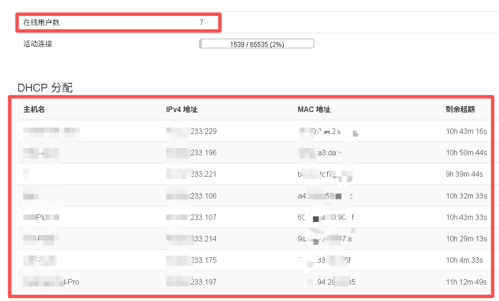

# 校园网 Dr.COM / ePortal 多设备共享绕过实战指南（2026/10/31 修订）

基于 OpenWrt 的校园网 **Web 版 Dr.COM / 哆点 ePortal** 防共享检测绕过。

测试环境：福建农林大学仓山校区 / 中国移动校园宽带 / Dr.COM ePortal 4.x

路由器：Xiaomi MiWiFi Mini（mt7620 / 128MB） / OpenWrt R24.8.1 / kernel 5.4.278

内网 11 台终端（Windows / iOS / Android / HarmonyOS 混合）
**经实测，可以稳定用网超过10小时**

**本教程侧重于原理剖析，而非无脑地教你执行，所以适合有一定技术基础的人阅读，你应至少同时具备：**
- OpenWrt / Linux 基础
- TCP/IP 与抓包能力
- 与 AI 协作的能力

---

## 🚨 免责声明

**1. 本项目仅供网络安全研究与学习交流使用，严禁传播，严禁商用，严禁用于不法用途！因使用本工具产生的一切后果由使用者自行承担。🚫**

**2. 请遵守学校相关管理规定，切勿用于恶意逃避监管，倡导遵规守纪！🙏**

**3. 我不提供帮助，感谢理解！🤝**

---

## 📄 开源协议

本仓库采用 Apache 2.0 开源协议。

---
## ❓ 可以适配其它学校吗？
理论上“核心思路”可以对全国 80% 以上的高校通用，特别是采用 Web版 Dr.COM / 哆点 ePortal 认证系统的。

## 目录

- [1. 对端到底在看什么](#1-对端到底在看什么)
- [2. 侦察：先把对手摸清楚](#2-侦察先把对手摸清楚)
- [3. 方案设计：四层架构](#3-方案设计四层架构)
- [4. 落地：逐条命令](#4-落地逐条命令)
- [5. 验证：怎么证明它真的生效](#5-验证怎么证明它真的生效)
- [6. 自愈：掉线自动重认证](#6-自愈掉线自动重认证)
- [7. 适配其它学校 checklist](#7-适配其它学校-checklist)

---


## 1. 对端到底在看什么

### 1.1 认证与会话模型

Dr.COM ePortal 的典型链路：

```
终端 → 路由器 NAT → 校园网接入层 → AC(城域网/BRAS) → RADIUS → 出口
```

AC 侧的一条会话记录（可从后文接口直接读到）大致长这样：

| 字段 | 含义 | 对我们的意义 |
|---|---|---|
| `online_ip` / `online_mac` | 会话绑定的 IP 与 MAC | **是路由器的 WAN IP/MAC**，不是内网设备 |
| `user_account` | 认证账号 | 一个账号 = 一条会话 |
| `is_bind_mac` | 是否绑 MAC | 为 1 时换 MAC 会掉线，为 0 时可自由换 |
| `phone_flag` | 是否被判定为移动端 | 由 UA/特征推导，可用于校验画像一致性 |
| `time_long` / 上下行字节 | 计费与流量 | 异常流量也会触发风控 |

**关键认知：在 NAT 后面，AC 只能看到一台设备。** 所谓"设备数量限制"在会话维度天然满足，真正要对付的只有**流量特征维度的共享检测**。

路由器侧的真实情况是这样的——一个 WAN IP，后面挂着一屋子设备：



而 AC 的自助服务页只有一行，还会给你打上"终端类型"标签（这台被记成了**移动终端**，TTL/UA 就得按移动端画像走）：


### 1.2 共享检测的七个维度

| # | 维度 | 探测原理 |
|---|---|---|
| 1 | IPv4 TTL | NAT 后 TTL 递减，127/63 混杂 = 多系统 |
| 2 | IPv6 HopLimit | 同上，且常被忘掉 |
| 3 | TCP SYN 指纹 | 窗口大小 / MSS / 窗口缩放 / 选项顺序因 OS 而异 |
| 4 | IPID 序列 | Windows 递增、Linux 随机，混杂即 NAT |
| 5 | UA / 客户端特征 | 明文 HTTP 头 |
| 6 | QUIC / HTTP3 | UDP 443 上有独立 TLS 指纹，**绕过一切 HTTP 归一** |
| 7 | 共享热点特征 | SSDP / mDNS / NetBIOS / LLMNR / WS-D 出公网 |

外加两条辅助判据：**单 IP 并发连接数**（上千条流 = 典型 NAT）和 **DNS/NTP 侧信道**（每台设备各自的解析与对时行为）。

### 1.3 一句话结论

> **TTL 只是入场券。** 想让 AC 相信"这里只有一台设备"，必须让**传输层**也只有一个协议栈——这就是本版新增的 L3「全 TCP 重发起」。

### 1.4 门户页与企业 App 的 JS 探针

发现了两处很聪明的设计，属于**非报文层**的旁路探测，必须单独防：

1. **门户页会尝试拿内网 IP。** JS 直接读不到，但 **WebRTC** 能把真实局域网地址（`192.168.x.x` / `10.x.x.x`）暴露出来。门户随后上报，后台一看"这账号的内网地址在私有网段深处"，基本可以断定躲在路由器后面——这就是"网络故障 146"的成因之一。
   - 处置：LAN 用冷门私有段（如 `10.77.0.1/24`）；浏览器安装 WebRTC Leak Shield 插件或禁用 WebRTC（`chrome://flags` 或 `about:config` 的 `media.peerconnection.enabled`）。
2. **门户页会上报浏览器 UA**，并与登录账号绑定的终端画像比对。UA 对不上同样进风控。
   - 处置：**先让 UA 归一上线，再用浏览器访问门户/自助服务**；顺序反了，你自己就是那个"异常终端"。
3. **学校自有 App（如"数字FAFU"）会扫局域网拓扑并向服务器上报。**
   - 处置：**用流量打开，别连 WiFi**。

> 一句话：报文层做得再干净，只要你自己用浏览器裸奔去点门户页，等于自首。

---

## 2. 侦察：先把对手摸清楚

### 2.1 识别厂商与版本

打开认证页，按 F12 看三处：

| 特征 | 结论 |
|---|---|
| `Server: DrcomServer1.0` | Dr.COM / 城市热点 |
| 页面里有 `a41.js`、`b80.css`、`b111.jpg` | Dr.COM 门户静态资源命名规律 |
| 响应体是 `jsonpReturn({...})` | ePortal 4.x JSONP 接口 |
| `authloginport=801` / `authloginpath='/eportal/?c=ACSetting&a=Login'` | 老接口在 4.x 已 404，实际走 REST |

```bash
curl -s http://AC_IP/ | head -40          # 拿静态页与版本注释
curl -sI http://AC_IP/ | grep -i server
```

### 2.2 还原认证协议（4.x）

实际登录是：

```
POST http://AC_IP:801/eportal/portal/login
Content-Type: application/x-www-form-urlencoded

login_method=1
user_account=<账号><@运营商后缀>
user_password=<明文密码>
wlan_user_ip=<WAN IP>
wlan_user_ipv6=
wlan_user_mac=<WAN MAC，大写去冒号>
wlan_ac_ip=<AC 侧 IP>
wlan_ac_name=<BRAS 名>
jsVersion=4.X
```

返回 `jsonpReturn({"result":1,...})` 即成功；失败时 `ret_code` 含义：

| ret_code | 含义 |
|---|---|
| 1 / 4 | 账号密码错或账号状态异常 |
| 2 | 终端 IP 已经在线 |
| 3 | 系统繁忙 |
| 5 / 6 | REQ_CHALLENGE 失败 / 超时 |
| 7 | Radius 认证失败 |

> ⚠️ **AC 一般有"连续失败 5 次锁号"**。调试阶段务必用错号试探，不要拿真账号反复试密码。

### 2.3 会话状态探针（本文最有用的一招）

绝大多数 Dr.COM ePortal 部署都暴露了这个**无需认证**的接口：

```
GET http://AC_IP:801/eportal/portal/online_list
    ?user_account=&user_password=
    &wlan_user_mac=<WAN MAC>
    &wlan_user_ip=<IP 的十进制>
    &curr_user_ip=<同上>
    &jsVersion=4.X
```

返回你自己的完整会话记录。它解决了一个致命问题：**"我到底在线吗？AC 现在认为我是几台设备？"**

```bash
# IP → 十进制（注意 32 位溢出，用 %.0f）
ip2dec() { echo "$1" | awk -F. '{printf "%.0f",$1*16777216+$2*65536+$3*256+$4}'; }
```

> 这条接口是信息泄露，但它属于对端自己的设计缺陷，用它做健康探针是**只读**行为。请勿用它查询他人账号。

### 2.4 掉线原因判别

把 `online_session`（会话 ID）和 `user_account` 记下来，掉线时对比：

| 现象 | 结论 |
|---|---|
| 会话消失，重新登录成功，账号不变 | 正常超时/被踢，自动重认证即可 |
| 会话仍在但 `user_account` 变了 | **同一 IP/MAC 被别的账号顶掉**（宿舍多人多账号常见） |
| 在线但 HTTP 被 302 到认证页 | **被判定共享 / 被限制** ← 这才是真正的风控信号 |

---

## 3. 方案设计：四层架构

```
┌─ L1 单点认证 ─────────────────────────────────────────────┐
│ 守护进程定时查 online_list，掉线才重认证                    │
│ 连续失败 2 次即自锁，绝不去撞 AC 的 5 次锁号                │
└───────────────────────────────────────────────────────────┘
┌─ L2 出口指纹归一 ─────────────────────────────────────────┐
│ TTL/HL 统一 · MSS clamp · QUIC 封杀 · 广播组播封杀          │
│ mDNS/SSDP/LLMNR/WS-D/NetBIOS/DHCP 封杀 · 单机连接数上限     │
│ 挂在 firewall.user 上，fw3 reload 后自动重建                │
└───────────────────────────────────────────────────────────┘
┌─ L3 全 TCP 重发起（核心）───────────────────────┐
│ PREROUTING -i br-lan → REDIRECT :端口 → 本地中转进程        │
│ 中转进程终结客户端 TCP，用自己的栈重开一条到真实目标        │
│   · 明文 HTTP：顺手改写 UA 为统一值                         │
│   · HTTPS / 其它 TCP：盲转发，TLS 端到端不变                │
│ 效果：11 台设备在 AC 眼里 = 1 套 Linux 协议栈               │
└───────────────────────────────────────────────────────────┘
┌─ L4 攻击面收敛 ───────────────────────────────────────────┐
│ uhttpd/dropbear 只监听 LAN（默认 0.0.0.0 会被校园网扫到）    │
└───────────────────────────────────────────────────────────┘
```

**为什么 L3 是关键**：L1/L2 只能骗过"看报文头"的检测；L3 让**所有出口连接都由路由器重新发起**，窗口大小、MSS、窗口缩放、TCP 选项顺序、IPID 序列一次性全部统一，不需要任何其他模块。

**代价**：所有 TCP 走一次用户态转发。实测 mt7620 上 1.8 MB/s → 2.0 MB/s，**无损**（Go 的 splice 直通）；128MB 内存占用可接受。若你的设备更弱，可只对 80/443 做重发起，或直接关掉 L3 只保留 L1/L2。

---

## 4. 落地：逐条命令

> 下面以 `WAN=eth0.2` 为例，`AC_IP` / `AC_WAN_IP` / `BRAS_NAME` 按自己抓包结果替换。

### 4.1 基线：MAC、网段、IPv6

1. **MAC 克隆**：WAN 口克隆"已被 AC 记录过的那台设备"的 MAC。
   - `uci set network.wan.macaddr='xx:xx:xx:xx:xx:xx'`
   - ⚠️ **画像必须一致**：克隆的是 PC 的 MAC，UA 和 TTL 就要按 PC 画像走；克隆的是手机的，就按手机画像走。见 4.2 的决策表。
2. **冷门 LAN 网段**：`10.77.0.1/24` 这类不常见的私有段，规避门户页 JS/WebRTC 对内网网段的探测。注意改了之后 LuCI 地址也变。
3. **彻底关 IPv6**：删 `wan6`；LAN 的 DHCPv6/RA/NDP 全关；`ip6tables` 也加 HL 归一（万一将来有 v6）。

```bash
ip -6 addr show scope global | grep -Ev 'inet6 (fd|fe)'   # 应该为空
```

### 4.2 TTL / HL / MSS：选一个画像，三件套对齐

| 画像 | TTL/HL | UA | 适用 |
|---|---|---|---|
| Windows PC | `128` | `...Windows NT 10.0; Win64; x64...Edg/xxx` | 账号在自助系统里登记为 PC |
| Android / Linux | `64` | `...Android 14; Pixel 7...Chrome/xxx Mobile` | 登记为手机，或不想装 PC 画像 |

```bash
# 出方向统一 TTL（v4）与 HopLimit（v6）
iptables  -t mangle -A POSTROUTING -o $WAN -j TTL --ttl-set 64
ip6tables -t mangle -A POSTROUTING -o $WAN -j HL  --hl-set  64

# ICMP 必须跟 TCP 用同一个值（老教程里 TCP 128 / ICMP 64 是自相矛盾的）
iptables -t mangle -A POSTROUTING -o $WAN -p icmp -j TTL --ttl-set 64

# MSS 钳制
iptables -t mangle -A POSTROUTING -o $WAN -p tcp --tcp-flags SYN,RST SYN -j TCPMSS --clamp-mss-to-pmtu
```

> **不要**盲目照抄 `128`。AC 如果先把你的账号画像记成了手机，突然出现 TTL=128 的流量，反而是异常。**改画像 = 换 MAC + 重登**，三件套一起换。

### 4.3 UA 统一：装完必须验证

两条路线，二选一：

**A. UA3F（NFQUEUE，轻量）**

```bash
opkg update && opkg install ua3f
uci set ua3f.enabled.enabled='1'
uci set ua3f.custom_ua.custom='Mozilla/5.0 (Linux; Android 14; Pixel 7) ...'
uci commit ua3f && /etc/init.d/ua3f restart
# 验证：进程 + NFQUEUE 规则都要在
ps w | grep ua3f
iptables -S | grep -i nfqueue
```

**B. UAmask / 其它 TPROXY 中转（可同时完成 L3）**

它能终结 TCP 并重写 UA，顺带把 HTTPS 盲转发，等于 4.7 和 4.3 一起做了。

**验证方法（必做）**：

```bash
# 从任意一台内网设备发请求，看服务端收到的 UA
curl -s http://httpbin.org/user-agent
# 期望：无论 Windows / iPhone / Android，返回的 user-agent 完全一致
```

### 4.4 封杀 QUIC（最容易被忽略的一环）

浏览器默认走 HTTP/3，UDP 443 上有独立的 TLS/QUIC 指纹，**UA 和 TCP 归一全部失效**。

```bash
iptables -A FORWARD -o $WAN -p udp -m multiport --dports 443,80 -j DROP
```

副作用：视频站首帧略慢，属正常。

### 4.5 封堵共享热点特征

```bash
# 广播 / 组播一律不出 WAN
iptables -A FORWARD -o $WAN -m pkttype --pkt-type broadcast -j DROP
iptables -A FORWARD -o $WAN -m pkttype --pkt-type multicast -j DROP

# SSDP / mDNS / LLMNR / WS-Discovery / NetBIOS / SMB
iptables -A FORWARD -o $WAN -p udp -m multiport --dports 1900,5353,5355,3702 -j DROP
iptables -A FORWARD -o $WAN -p udp -m multiport --dports 137,138 -j DROP
iptables -A FORWARD -o $WAN -p tcp -m multiport --dports 139,445 -j DROP

# DHCP 泄漏
iptables -A FORWARD -o $WAN -p udp -m multiport --dports 67,68 -j DROP
```

> 常见误区：漏了 **LLMNR(5355)** 和 **WS-Discovery(3702)**——Windows 网络上这两样出公网，等于自报"我家有台 Windows"。

### 4.6 DNS / NTP 接管 + 并发限制

```bash
iptables -t nat -A PREROUTING -p udp --dport 53  -j REDIRECT --to-ports 53
iptables -t nat -A PREROUTING -p tcp --dport 53  -j REDIRECT --to-ports 53
iptables -t nat -A PREROUTING -p udp --dport 123 -j REDIRECT --to-ports 123

# 单机并发上限：既防"单 IP 上千条流"的 NAT 特征，也保护小内存路由器
iptables -A FORWARD -i br-lan -p tcp -m connlimit --connlimit-above 400 --connlimit-mask 32 \
  -j REJECT --reject-with tcp-reset
```

### 4.7 全 TCP 重发起（核心）

**原理**：`REDIRECT` 把 LAN 的 TCP 连接改投到本机端口，中转进程用 `SO_ORIGINAL_DST` 取回原始目标，再以自己的协议栈重新建连。

```bash
# 中转进程（示例：UAmask，REDIRECT/TPROXY 模式，监听 12032）
/usr/bin/UAmask -port 12032 -u "$UA" &

# 分流：校园网/内网/回环/DNS 直连，其余全部重发起
iptables -t nat -N CAMPUS_RELAY
iptables -t nat -A CAMPUS_RELAY -d $AC_IP -j RETURN
for n in 10.0.0.0/8 172.16.0.0/12 192.168.0.0/16 127.0.0.0/8 169.254.0.0/16; do
  iptables -t nat -A CAMPUS_RELAY -d $n -j RETURN
done
iptables -t nat -A CAMPUS_RELAY -p tcp --dport 53 -j RETURN
iptables -t nat -A CAMPUS_RELAY -p tcp -j REDIRECT --to-ports 12032
iptables -t nat -I PREROUTING 1 -i br-lan -j CAMPUS_RELAY
```

**必须配一个看门狗**：中转进程一挂，全屋断网。守护脚本里每轮检查端口，没在监听就立刻摘掉跳转：

```bash
if ! netstat -ltn | grep -q ':12032 '; then
  while iptables -t nat -D PREROUTING -i br-lan -j CAMPUS_RELAY 2>/dev/null; do :; done
fi
```

### 4.8 持久化：别让 fw3 把你的规则冲掉

`iptables` 手工规则在 LuCI 点一次「保存并应用」后就会消失。正确做法是写进 `/etc/firewall.user`，并**用 `-C` 去重**（否则每次重载都会叠加一条）：

```bash
iptables -t nat -C PREROUTING -p udp --dport 53 -j REDIRECT --to-ports 53 2>/dev/null || \
  iptables -t nat -A PREROUTING -p udp --dport 53 -j REDIRECT --to-ports 53

/usr/sbin/campus-normalize apply   # 其余规则封装成脚本，内部同样用 -C 去重
```

用 procd 起守护服务，开机自启：

```bash
/etc/init.d/campus enable
/etc/init.d/campus start
```

---

## 5. 验证：怎么证明它真的生效

**四个实验，缺一不可。**

### 5.1 UA 一致性（三终端）

| 客户端实际发送 | 服务端实际收到 |
|---|---|
| Windows / Edg 124 | `Mozilla/5.0 (Linux; Android 14; Pixel 7) ... Chrome/131 ...` |
| iPhone / Safari 17.4 | 同上 |
| Android Dalvik | 同上 |

三者一致 → UA 层通过。

### 5.2 流量确实被重发起（conntrack 双向证据）

```bash
grep '<目标IP>' /proc/net/nf_conntrack
```

```
LAN→AC  : src=10.20.30.40    dst=203.0.113.10 dport=443     ← 客户端原始流
回程     : src=10.20.30.1     sport=12032                    ← 被 REDIRECT 到代理
代理出口 : src=198.51.100.5   dst=203.0.113.10 sport=43004   ← 路由器重开的新连接
```

出现第三行，说明重发起成功。

### 5.3 规则幂等

```bash
/etc/init.d/firewall reload; /etc/init.d/firewall reload
iptables -t mangle -S | grep -c ttl-set        # 期望 1
iptables -t nat -S PREROUTING | grep -c 'dport 53'   # 期望 2
```

数字增长说明你的 `-A` 没有 `-C` 守卫，规则会无限叠加。

### 5.4 会话表

```bash
campus-auth status      # online / offline
curl -s "http://AC_IP:801/eportal/portal/online_list?...&total"   # total=1
```

---

## 6. 自愈：掉线自动重认证

守护循环（60s）：

```
查 online_list
 ├─ 在线：健康探针；若 HTTP 被 302 → 记 HIJACK 告警
 └─ 离线：自动 POST /eportal/portal/login
      ├─ 成功 → 清计数
      └─ 失败 2 次 → 写 /tmp/campus_auth_disabled，彻底停手
```

**为什么失败 2 次就停手**：AC 普遍是 5 次锁号。自动重试最忌讳"密码填错了还在后台每 60 秒撞一次"。

---
